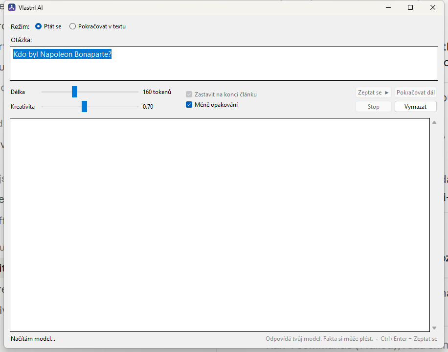

# Vlastní AI

Dvě fáze. Fáze 1 je opravdu tvůj model od nuly, fáze 2 je použitelný asistent.
Všechno běží lokálně, žádné API. Projekt leží v `E:\vlastni-ai`.

**Vlastní jazykový model (Transformer, 97,5 M parametrů) napsaný od nuly v PyTorchi** – vlastní architektura, vlastní tokenizer a trénink na české Wikipedii (1,3 GB textu, 356 M tokenů, 30 000 kroků, perplexita 14,4). K tomu okno, ve kterém se modelu ptáš nebo v textu necháš pokračovat.

<p align="center"></p>

*Okno programu (režimy „Ptát se“ a „Pokračovat v textu“, posuvníky délky a kreativity).*

> Natrénované váhy (`out/*.pt`, ~1 GB) a stažená Wikipedie jsou kvůli velikosti mimo repozitář – vytvoříš je skripty níže (`download_wiki.py` → `prepare.py` → `train.py`).

## Program

Ikona **Vlastní AI** na ploše nebo v nabídce Start (dá se najít i vyhledáním)
otevře okno se dvěma režimy:

- **Ptát se** — napíšeš otázku („Kdo byl Napoleon Bonaparte?"), klikneš
  **Zeptat se** (nebo Ctrl+Enter) a odpoví tvůj model doučený odpovídat
  (`out/model_qa.pt`). Otázky se skládají pod sebe; model si předchozí
  nepamatuje, každá je samostatná.
- **Pokračovat v textu** — napíšeš začátek textu a tvůj model od nuly
  (`out/model.pt`) v něm pokračuje. **Pokračovat dál** naváže na to, co už
  je v okně.

Posuvníky mění délku a kreativitu. Dokud se model načítá (pár vteřin po
spuštění, dole „Načítám model…"), jsou tlačítka šedá.

Ručně se spouští takhle:

```bash
E:\vlastni-ai\.venv\Scripts\pythonw.exe E:\vlastni-ai\program.pyw
```

### Proč to není `.exe`

Ve složce leží `Vlastni AI.exe` (zdroj a `build.cmd` v `launcher\`), ale
**Smart App Control ho blokuje** — pustí jen programy podepsané důvěryhodným
certifikátem nebo se známou reputací a vlastnoručně přeložený `.exe` není ani
jedno. Stejně by dopadl i velký samostatný `.exe` s PyTorchem uvnitř. Proto se
program spouští přes zástupce, který volá Python přímo. Kdyby se Smart App
Control někdy vypnul, `.exe` začne fungovat beze změny.

Ikona je `launcher\ikona.ico` (nakreslená skriptem, bez cizích obrázků).

## Co je co

| Soubor | K čemu |
|---|---|
| `program.pyw` | **Program s oknem** — to, co otevírá ikona na ploše. |
| `make_qa.py` | Z tvé Wikipedie vyrobí dvojice otázka → odpověď pro doučení. |
| `finetune_vlastni.py` | Doučí tvůj model odpovídat na otázky → `out/model_qa.pt`. |
| `model.py` | Transformer od nuly — RMSNorm, RoPE, SwiGLU, flash attention. Žádná cizí architektura, žádné cizí váhy. |
| `tokenizer.py` | Vlastní byte-level BPE, natrénovaný na tvých datech. |
| `config.py` | Presety velikosti modelu, autodetekce podle VRAM. |
| `download_wiki.py` | Stáhne českou Wikipedii jako čistý text do `data/`. |
| `clean_wiki.py` | Přežene už stažený text čističem znovu, bez nového stahování. |
| `demo_data.py` | Umělý korpus na rychlý test celé pipeline. |
| `prepare.py` | Z `data/*.txt` udělá tokenizer + `out/train.bin`. Zvládne i korpus větší než RAM. |
| `train.py` | Trénink. Ctrl+C kdykoliv, checkpoint se uloží. |
| `stav.py` | Kolik procent tréninku je hotovo a kolik zbývá. |
| `chat.py` | Generování textu vlastním modelem v terminálu. |
| `trenuj_dal.cmd` | Dohlížeč pro Windows — spustí trénink a po pádu ho nahodí znovu. |
| `setup_wsl.sh`, `trenuj_dal.sh`, `trenuj_wsl.cmd` | Totéž v Linuxu (WSL), viz „Smart App Control" níž. |
| `finetune.py` | Fáze 2 — QLoRA fine-tune otevřeného modelu na `data/chat.jsonl`. |
| `assistant.py` | Chat s doladěným asistentem. |

## Fáze 1 — vlastní model od nuly

Hotovo: 30 000 kroků, 24,6 h tréninku, nejlepší perplexita **14,4**.

Data (česká Wikipedie, CC BY-SA):

```bash
.venv\Scripts\python download_wiki.py
```
```bash
.venv\Scripts\python prepare.py
```
```bash
.venv\Scripts\python train.py
```
```bash
.venv\Scripts\python chat.py -p "Praha je"
```

Chceš vlastní texty? Nasyp `.txt` do `data/` a spusť znovu `prepare.py`
a `train.py`.

### Jak je na tom trénink

```bash
.venv\Scripts\python stav.py
```

Ukáže procenta, krok, tempo, odhad konce a poslední perplexitu. Tempo počítá
jen z aktuálního běhu a jako medián, takže ho jeden ulítlý řádek nerozhodí.

### Parametry

- Korpus: 422 312 článků, 1,3 GB textu, **356 M tokenů** (3,84 znaku/token)
- Slovník: 16 384 tokenů, vlastní BPE
- Model: preset `medium`, 97,5 M parametrů
- Trénink: 30 000 kroků × 36 864 tokenů = 1,11 B tokenů (~3 průchody korpusem)
- Tempo na RTX 3050 s `--batch-size 3`: **~4,1 s/krok**, 3,1 GB VRAM
- S hrou na pozadí klesne tempo na 7–11 s/krok — o kartu se dělí

### Presety

Hodnoty VRAM jsou **naměřené** na RTX 3050, ne odhadnuté.

| Preset | Parametry | Kontext | VRAM | Na této kartě |
|---|---|---|---|---|
| `tiny` | 11M | 256 | 0,8 GB | ✓ |
| `small` | 30M | 512 | 1,75 GB | ✓ |
| `medium` | 98M | 512 | 3,41 GB | ✓ ← autodetekce vybere tenhle |
| `large` | 320M | 1024 | 10,45 GB | ✗ přeteče do systémové RAM, běží pomalu |

### Co od fáze 1 čekat

Model píše plynulou, gramaticky správnou češtinu ve stylu Wikipedie.
**Není to chatbot** — na otázky neodpovídá, pokračuje v textu. Fakta si
vymýšlí (98 M parametrů stačí na jazyk, ne na znalosti světa). Proti
opakování pomáhá postih za opakování a proti odbíhání k jinému tématu
zastavení na konci článku — obojí je v programu i v `chat.py` zapnuté.

## Ptát se — tvůj model doučený odpovídat

Žádný cizí model ani stažená data. Tvůj model od nuly se doučí na dvojicích
otázka → odpověď vyrobených z tvé Wikipedie:

```bash
.venv\Scripts\python make_qa.py
```
```bash
.venv\Scripts\python finetune_vlastni.py
```

- `make_qa.py` udělá z názvu článku otázku („Kdo byl Ludvík XIV.?", „Co je
  astronomie?") a z prvních vět úvodu odpověď. Lidi pozná podle dat v závorce
  (`(* 1950)` nebo `(1638 – 1715)`). Část otázek je malými písmeny a bez
  diakritiky a část jen s příjmením („kdo byl hitler?"), protože tak se
  lidé ptají. Výsledek: `out/qa_train.jsonl` a `out/qa_val.jsonl`.
- `finetune_vlastni.py` vezme `out/model.pt`, učí ho jen na odpovědích
  (otázky se do chyby nepočítají) a nejlepší stav uloží do `out/model_qa.pt`.
  Původní model zůstane beze změny. Umí `--vykon 0.5` jako trénink.

Model se naučí **odpovídat k věci**, ale **fakta plete dál** — 98 M
parametrů si z Wikipedie zapamatuje jen část. Průběh je v `qa_trenink.log`.

## Běh na pozadí a pojistky

Spuštění nezávislé na Claude (přežije jeho zavření):

```bash
trenuj_dal.cmd
```

Volitelně s výkonem — `trenuj_dal.cmd 0.5` nechá půlku času grafiku volnou pro hry.

- **Výpadek paměti grafiky** (hra si ji vezme) — krok se zopakuje, až 20×.
- **Záloha každých 100 kroků** do `out/model_last.pt` — pád stojí pár minut.
- **Dohlížeč** — po pádu restart do minuty od poslední zálohy. Pojistka proti
  dvojímu spuštění. Po **5 pádech po sobě bez jakéhokoli postupu** to vzdá
  a zapíše důvod do `trenink.log`.
- **Naplánovaná úloha `VlastniAI-Trenink`** — po přihlášení do Windows spustí
  dohlížeč. Vypnout: Plánovač úloh → `VlastniAI-Trenink` → Zakázat.

Parametry `train.py`: `--resume` naváže od nejnovější zálohy, `--vykon 0.05–1`
omezí zátěž grafiky, `--batch-size N` sníží paměť (počet tokenů na krok zůstane
stejný, dopočítá se víc průchody).

## Smart App Control a WSL

Windows 11 má zapnutý **Smart App Control**, který blokuje knihovnu PyTorche
(`torch_python.dll`, v logu `WinError 4551`). Rozhoduje podle reputace v cloudu
Microsoftu a verdikt se mění — 6.–10. září blokoval, 10. září v 9:55 pustil.

Spolehlivé řešení bez vypínání ochrany je **WSL2** — trénink běží v Linuxu,
na který se tahle kontrola nevztahuje, a grafiku používá přes ovladač z Windows.

1. PowerShell **jako správce**:
   ```bash
   wsl --install -d Ubuntu-24.04
   ```
2. Restart PC, při prvním spuštění Ubuntu si zvolíš jméno a heslo.
3. V Ubuntu (zeptá se jednou na heslo):
   ```bash
   bash /mnt/e/vlastni-ai/setup_wsl.sh
   ```
   Zkopíruje projekt do Linuxu, nainstaluje PyTorch a ověří grafiku.
4. Spuštění z Windows: `trenuj_wsl.cmd` (a naplánovanou úlohu přesměrovat na něj).

Před krokem 3 musí trénink ve Windows stát, jinak by se mohla zkopírovat
rozepsaná záloha.

Smart App Control **nevypínej** kvůli tomuhle — na většině verzí Windows 11 ho
pak nejde zapnout zpátky bez přeinstalace systému.

## Fáze 2 — vlastní asistent

Balíčky navíc:

```bash
.venv\Scripts\python -m pip install transformers peft datasets accelerate bitsandbytes
```

Data do `data/chat.jsonl`, jeden příklad na řádek:

```json
{"messages":[{"role":"user","content":"otázka"},{"role":"assistant","content":"odpověď"}]}
```

Pak:

```bash
.venv\Scripts\python finetune.py --check
```
```bash
.venv\Scripts\python finetune.py
```
```bash
.venv\Scripts\python assistant.py
```

Základní model se vybere podle VRAM: 6 GB → Qwen2.5-3B, 8–15 GB → 7B,
16 GB+ → 14B, vše ve 4 bitech. Trénují se jen LoRA adaptéry (desítky MB),
základ zůstává zmrazený. Adaptér v `out/lora/` je tvůj.

## Prostředí

- Python 3.12 v `.venv`, PyTorch 2.14 + CUDA 12.6. Prostředí bylo
  zkopírované z `C:\Users\maxid\vlastni-ai`; základní Python leží pořád
  v `C:\Users\maxid\AppData\Local\Python\pythoncore-3.12-64` a musí tam zůstat.
- Balíčky instaluj přes `.venv\Scripts\python -m pip`, ne přes `pip.exe` —
  to po přesunu složky funguje spolehlivě.
- Systémový Python 3.14 je rozbitý (chybí mu stdlib) — nepoužívej ho.
- **Avast** rozbaluje HTTPS vlastním certifikátem, kterému Python nevěří.
  V `.venv` je proto `truststore` (načítá ho `sitecustomize.py`), díky kterému
  Python ověřuje certifikáty proti úložišti Windows.
